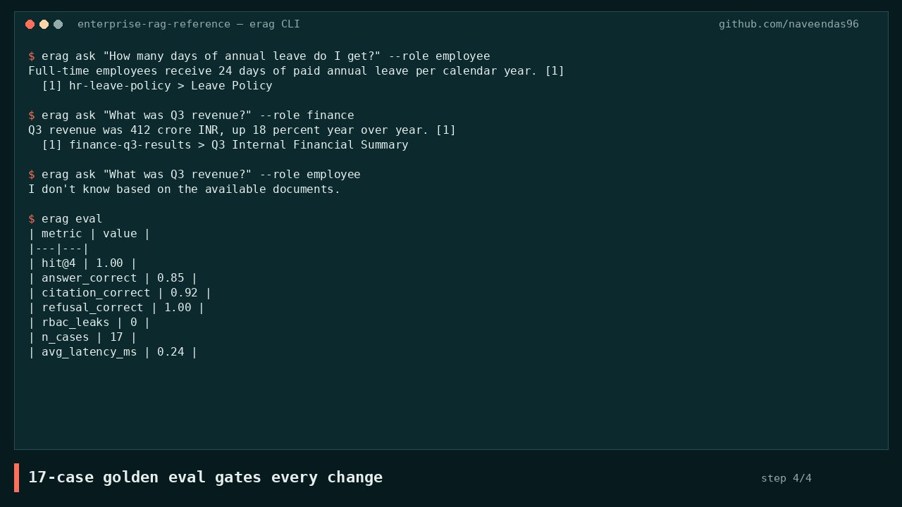
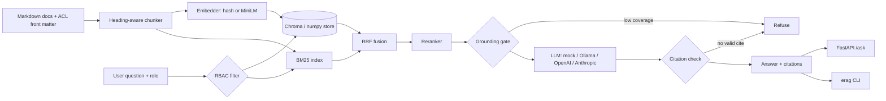

# Enterprise RAG Reference Architecture

A reference implementation of **retrieval-augmented generation (RAG) the way an enterprise has to run it**: answers are grounded and cited, document-level access control is enforced, the system refuses when it doesn't know, and an eval gates every change.

[](docs/demo/demo.mp4)

*Demo recorded from the real CLI output ([MP4](docs/demo/demo.mp4)). More projects: [thenavasoft.com/projects](https://thenavasoft.com/projects.html)*

## Problem
Most RAG demos answer anything, cite nothing and ignore who is asking. In an enterprise, the questions that matter are *"Can an employee see the Q3 financials through the chatbot?"* and *"What happens when the documents don't contain the answer?"* This repo answers both with code and measures the result.

## Architecture


## Key design decisions
| # | Decision | Why |
|---|---|---|
| [0001](docs/adr/0001-hybrid-retrieval-rrf.md) | Hybrid BM25 + vector with RRF | Exact terms *and* paraphrases |
| [0002](docs/adr/0002-rbac-before-retrieval.md) | ACL filter before ranking | Restricted text never reaches the prompt |
| [0003](docs/adr/0003-grounded-refusal.md) | Two-gate refusal | No uncited answers |
| [0004](docs/adr/0004-pluggable-local-first.md) | Pluggable, local-first models | $0 CI, swap providers with an env var |

## Eval results (real run, `make eval`, defaults: mock LLM, hash embedder)
Golden set: 17 cases (13 answerable across 4 roles, plus 4 that must be refused: 2 RBAC denials and 2 out of scope).

| metric | value |
|---|---|
| hit@4 (retrieval) | 1.00 |
| answer_correct | 0.85 |
| citation_correct | 0.92 |
| refusal_correct | 1.00 |
| rbac_leaks | 0 |
| avg_latency_ms | 0.32 |

```
$ erag ask "How many days of annual leave do I get?" --role employee
Full-time employees receive 24 days of paid annual leave per calendar year. [1]
  [1] hr-leave-policy > Leave Policy
```

## Quickstart
```bash
python3.11 -m venv .venv && . .venv/bin/activate
make install && make test && make eval
erag ask "What was Q3 revenue?" --role finance     # answered
erag ask "What was Q3 revenue?" --role employee    # refused (RBAC)
make serve   # curl -X POST localhost:8000/ask -H 'x-user-role: hr' -d '{"question":"..."}'
# Real models (optional):
make install-ml && EMBEDDER=st VECTOR_STORE=chroma LLM_PROVIDER=ollama LLM_MODEL=llama3.2:1b erag ask "..."
```
Docker: `docker compose up` (add `--profile ollama` for a local LLM).

## Cost note
The defaults cost **$0**: no API keys, no model downloads, CPU only, and the eval runs in under a second. The optional MiniLM embedder is about 90 MB on CPU. With a hosted LLM, each answer is about 600 input and 60 output tokens, so 10k questions on a small model (gpt-4o-mini or Claude Haiku class) cost roughly **$1 to $4**. Retrieval and refusal gates skip the LLM call entirely for refused questions.

## Limitations
- The default mock LLM is extractive (it picks the best sentence), so answer quality numbers reflect retrieval and gating, not generation.
- The reranker is a lexical scorer. Swap in a cross-encoder for production.
- The role comes from an HTTP header in the demo. In production it should come from verified IdP claims.
- The corpus and golden set are small and synthetic.

## License
MIT
